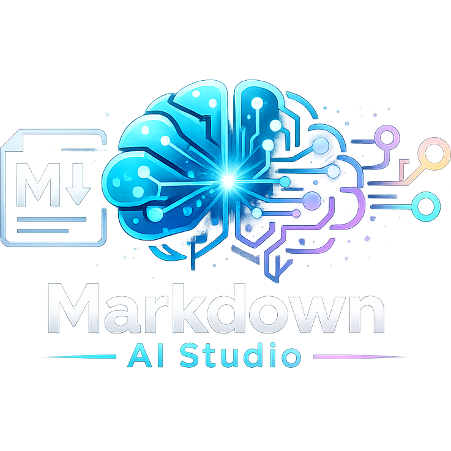

# AI Markdown Studio Community

  

AI Markdown Studio Community is the MIT-licensed open-source core of AI Markdown Studio. This repository contains the Community VS Code extension and the shared packages used to render, preview, and author Markdown documents and presentations.

AI Markdown Studio Pro is a separate product that extends Community with AI theme generation, file conversion, PDF/PPTX export, high-fidelity DOCX, additional document/theme Copilot tools, shared custom theme folders, and corporate PowerPoint template automation. Pro is a standalone extension; users do not need to install Community alongside it.

## Repository

- [Community extension README](./apps/ai-markdown-studio-vs-community/README.md) - installation, tutorials, features, and user help
- [Shared packages](./packages/) - Markdown rendering, preview, and other shared functionality
- [Documentation index](./docs/README.md) - user guides, references, and examples

## License

MIT. See [LICENSE](LICENSE).
