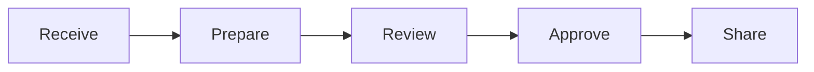

<!--slide: content-->
<!-- slide-label -->
Illustrative report

# Delivery overview

<!-- slide-subtitle -->
Fictional example · reporting period: 1–14 October

## Summary

- Four teams are being reviewed.
- Design work is progressing across the teams.
- The next checkpoint is the end of October.

<!-- region-break -->

## Scope of this report

```metric
{"title":"Teams reviewed","value":4,"unit":"teams","subtitle":"Illustrative data"}
```

---

<!--slide: content-->
<!-- slide-label -->
Illustrative status

# Delivery by team

~~~component
type: status-matrix
version: 1
data:
  columns:
    Define: [Scope, Review]
    Deliver: [Design, Release]
  statuses:
    Ready: success
    Active: info
    Planned: neutral
  rows:
    - label: Research
      detail: Team North
      cells:
        Scope: Ready
        Review: Ready
        Design: { status: Active, progress: "1/2" }
        Release: Planned
    - label: Service
      detail: Team East
      cells: { Scope: Ready, Review: Active, Design: Planned, Release: Planned }
    - label: Operations
      detail: Team South
      cells: { Scope: Ready, Review: Ready, Design: Active, Release: Planned }
    - label: Support
      detail: Team West
      cells: { Scope: Ready, Review: Active, Design: Planned, Release: Planned }
options:
  showLegend: true
~~~

---

<!--slide: two-column-->
# Completed and upcoming

## Completed

- Research scope reviewed.
- Service team agreed the initial plan.
- Operations prepared a design brief.

<!--column-break-->

## Upcoming

- Review the service proposal.
- Continue the research design.
- Confirm the next team checkpoint.

---

<!--slide: content-->
# Example work items by team

The chart uses fictional counts for the four teams in this example.

```vega-lite
{
  "title": "Work items in review",
  "data": {
    "values": [
      {"team":"Research","items":3},
      {"team":"Service","items":2},
      {"team":"Operations","items":1},
      {"team":"Support","items":4}
    ]
  },
  "mark": "bar",
  "encoding": {
    "x": {"field":"team","type":"nominal","sort":null,"axis":{"labelAngle":0,"labelFontSize":16,"title":null}},
    "y": {"field":"items","type":"quantitative","title":"Items","axis":{"tickCount":5,"format":"d","labelFontSize":16,"titleFontSize":16}},
    "tooltip": [{"field":"team","type":"nominal"},{"field":"items","type":"quantitative"}]
  }
}
```

---

<!--slide: content-->
# Team checkpoints

## Research

- Scope reviewed
- Design in progress

<!-- region-break -->

## Service

- Plan agreed
- Proposal in review

<!-- region-break -->

## Operations

- Brief prepared
- Design in progress

<!-- region-break -->

## Support

- Scope reviewed
- Checkpoint pending

---

<!--slide: content-->
# Example review process

Five illustrative steps, shown with an existing Mermaid diagram.


