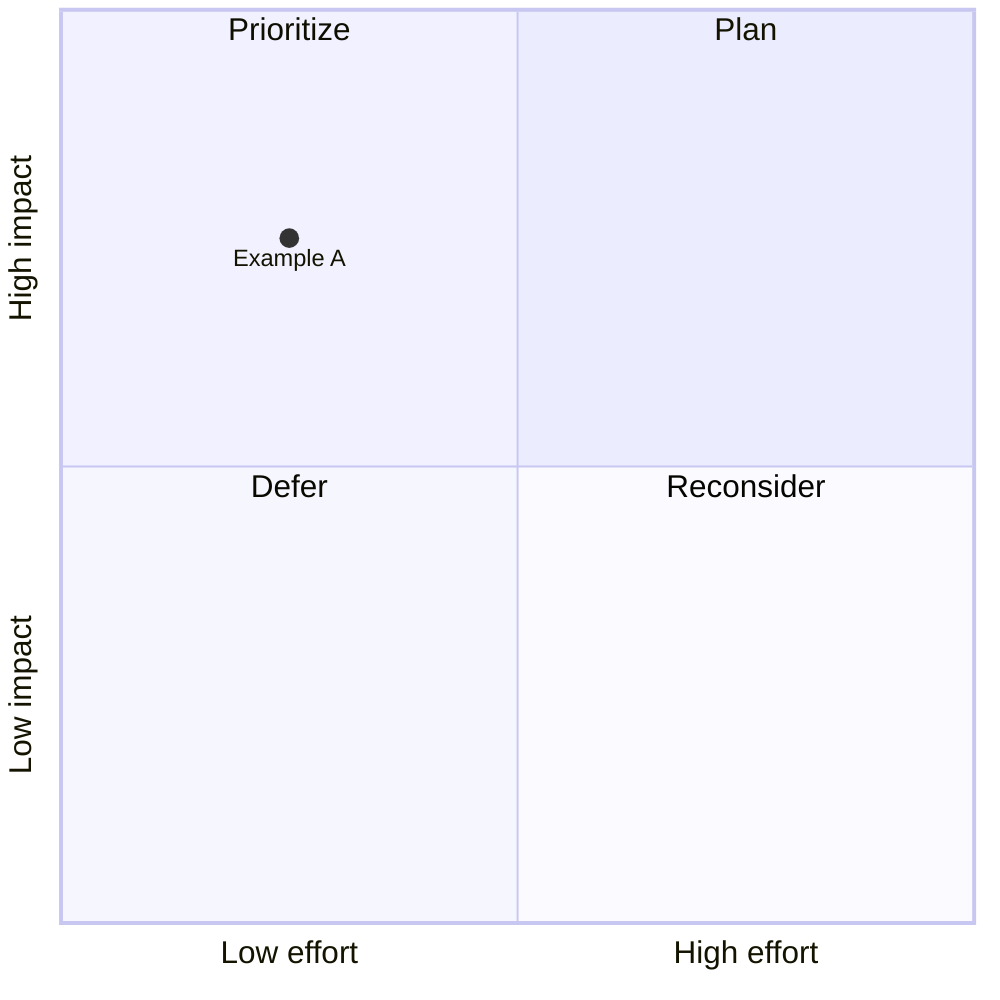

# Markdown AI Studio feature selection and authoring

<!-- Generated by packages/ai-core/build-authoring-assets.mjs. -->

Feature selection:
- Choose features by reader intent, even if the brief names no Markdown features.
- Before drafting, silently identify what each major section or slide must help the reader understand or decide. Consider the options below, then choose the simplest format that does the job. Respect requests for plain Markdown, the audience, available evidence, and the intended export.
- Before delivery, silently review the draft for material opportunities missed (for example, a process hidden in bullets or a trend buried in a table). Add a feature only if it improves comprehension. Remove decorative or redundant features; do not output the checklist.
- Explain relationships with Mermaid: decisions/process → flowchart; messages → sequence; lifecycle → state; entities → ER; schedule → Gantt; milestones → timeline; two-criteria prioritization → quadrantChart; causes → Ishikawa; flows with quantities → Sankey.
- Show quantitative evidence with Vega-Lite: compare → bar/grouped bar; trend → line/area; correlation → scatter; distribution → histogram/boxplot/tick; two-axis intensity → heatmap; geography → geoshape. Use a metric for one key number; use a table for exact lookup.
- Consider combined Vega-Lite charts: actuals vs target → bar + rule; observations vs trend → line + points; uncertainty → line + band; aligned group comparisons → facet/repeat; related measures on different scales → separate aligned views, not dual axes by default.
- Show definitions, equations or derivations with KaTeX ($...$ inline, $$ on separate lines for display). Use emoji sparingly for tone or scanning; keep semantic labels in text and avoid emoji in formal materials unless requested.
- For structured material, consider status-matrix for cross-item status/progress, record-list for records with metadata, and fact-cards for a small set of supplied facts. Do not infer missing values. Prefer lists, prose, callouts or ordinary tables when clearer.

## Mermaid: explain structure or relationships

| Reader intent | Consider |
| --- | --- |
| Decisions, branching, handoffs or cause-and-effect paths | `flowchart`; use subgraphs for ownership lanes where helpful |
| Messages, API calls or interactions over time | `sequenceDiagram` with participants and ordered events |
| Lifecycle, transitions, terminal states | `stateDiagram-v2` |
| Entities, relationships and cardinality / object structure | `erDiagram` for entities; `classDiagram` for types and behavior |
| Schedule with durations and dependencies / milestone narrative | `gantt` for schedules; `timeline` for milestones |
| Priority or positioning on two named criteria | `quadrantChart` with meaningful axes and supplied placements; if placements are unknown, use a criteria table |
| Causes grouped around a problem | Ishikawa (`ishikawa-beta`); use a cause tree if the target renderer lacks support |
| Quantities moving between stages or categories | `sankey-beta`; use flows and amounts supported by the data |
| System boundaries and dependencies | C4 context, architecture or block diagram; use a flowchart for portability |
| Cluster ideas / organize a tree / show overlap | `mindmap` / tree view / Venn; use nested lists or a table for portability |
| Trace requirements or show branching history | `requirementDiagram` or `gitGraph` |
| Show user experience stages or work queues | `journey` or `kanban`; do not guess experience scores or work status |
| Map a value chain by evolution / choose a response by decision context | Wardley map / Cynefin when the brief provides the necessary classifications and the target supports the syntax |
| Show precise layout or syntax | Packet or railroad diagram when the target renderer supports it; use a table or code sample otherwise |

Use a `mermaid` fence. For flowcharts on wide slides, start with `LR`; choose other directions if they fit better. Do not force a flowchart when another diagram fits. Keep labels short and verify complex or beta types in the target preview/export; fall back to a simpler diagram or text when support is uncertain. Prefer Vega-Lite when the main task is quantitative comparison or analysis.

Illustrative quadrant (positions are examples, not defaults):



## Vega-Lite and metrics: choose the encoding

| Reader intent | Consider |
| --- | --- |
| Compare or rank categories | Sorted bar; preserve units and start magnitude bars at zero |
| Compare subgroups or show contributions to totals | Grouped bars with `xOffset` / `yOffset` for comparison; stacked bars for composition with a meaningful total |
| Show change over time | Line for ordered trends; area when magnitude from a meaningful baseline matters |
| Explore a relationship between two measures | Scatter; include one row per observation and do not imply causation |
| Show spread, outliers or concentration | Histogram (`bar` with bin and count), tick plot for individual observations, or boxplot for group summaries |
| Find hotspots or patterns across two dimensions | Heatmap (`rect` + color); define the aggregation when several rows share a cell |
| Compare parts of a meaningful whole | Prefer sorted or stacked bars; use `arc` pie/donut only for a few non-negative shares of one total |
| Show a spatial pattern | `geoshape` with supplied inline GeoJSON; use ranked bars when location itself does not matter |
| Report a single value with context | `metric` with unit and period; include a change only when supported |
| Support exact lookup or charting without sufficient data | Prefer a table for known values; describe missing data rather than inventing a visual |

### Combined charts

| Reader intent | Consider |
| --- | --- |
| Actuals vs target | Layer bars and a rule on one scale for a shared target, ticks for per-category targets, or a target line when the target changes over time |
| Trend with observed points | Layer line + point, or use `mark.point` when they represent the same series |
| Trend or estimate with uncertainty | Layer line + band or points + error bars. Explain the interval and use supplied bounds or justified native summaries of supplied observations |
| Call out a meaningful event or threshold | Layer a `rule` or concise label at the supplied position; avoid duplicate legends |
| Show a rate alongside volume | Prefer aligned, concatenated views with the same time axis. Use a combo chart with independent axes only if units and scales are explicit and the comparison is not misleading |
| Compare the same encodings across groups or fields | Use `facet` for group values and `repeat` for fields. Share scales when comparing absolute levels |
| Show related but different views | Use `concat`, `hconcat`, or `vconcat`; use separate chart and metric fences when a dashboard would otherwise be dense |

Declarative visualization syntax (when selected):
- Preserve supplied values, labels, units, and dates; do not invent or silently fill missing data. Put native Vega-Lite JSON in a vega-lite fence, or metric JSON in a metric fence.
- Use inline data.values (or inherit parent data), strict JSON, and valid Vega-Lite marks and encodings. Do not emit data.url, external datasets, expressions, transforms, params, filters, selectors, config, hyperlink encodings, SVG/HTML image data, or executable properties. Remote chart data stays disabled; HTTPS chart image marks obey the workspace policy.
- Keep charts within 5000 data rows and 32 composed views. Use xOffset or yOffset for grouped bars, bin and count for histograms, and explicit labels, units, and tooltips.
- Metric JSON requires title and a finite numeric value. Optional: unit, subtitle, trend {value, direction, unit?, period?}. Direction is up for positive, down for negative, flat for zero; add trend only when supported by the data.
- Charts preview and export to interactive HTML. Do not promise native chart conversion in DOCX or PPTX; use a table or text when the destination cannot carry the visualization.
- Do not use chart fences, Chart.js datasets, HTML widgets, JavaScript, or new slide directives.
- Supported chart marks: arc, area, bar, boxplot, circle, errorband, errorbar, geoshape, image, line, point, rect, rule, square, text, tick, trail. Use the native mark and encoding properties for each chart form. Charts are validated against the installed Vega-Lite schema, not a short example allowlist.
- Supply data.values or inherit inline data from a parent composition. Use scalar fields for ordinary charts, or valid inline GeoJSON features/geometries for geoshape. Encodings follow native Vega-Lite: secondary positions may omit type, rule can have one positional channel, arc uses theta, text uses text, trail can use order/detail/size, and constant encodings use value. Field names must resolve to supplied data; safe dotted paths may reference nested GeoJSON properties.
- Supported composition forms: concat, facet, hconcat, layer, vconcat. Use parent data and shared layer encodings, spec for facet/repeat, and field: {"repeat":"column"} for repeated fields. Compositions are bounded to 32 rendered views after facet/repeat expansion.
- Grouped bars use xOffset or yOffset with a categorical field. A categorical axis can sort by "-y" or "-x". Histograms use bin: true or bin: {"maxbins":20} on a quantitative axis and aggregate: "count" on the other. Native field aggregates and sorting objects are supported; count can omit field.
- Native static mark properties are supported, including text/font options, stroke styles, image width/height, and composite uncertainty options. Do not use expression objects for mark properties. For geoshape use inline GeoJSON and projection; for image use supplied HTTPS or PNG/JPEG/GIF/WebP data URLs. Remote chart images follow allowRemoteResources; inline raster images work offline.
- Optional chart properties: title, description, width ("container" or 40-4096), height (40-4096), autosize. Use native encoding channels. Use explicit tooltip fields for concise values. Omit fixed dimensions to use responsive defaults.
- On presentation content slides, omit top-level width and height for single-view and layered charts unless fixed dimensions are explicitly requested. Charts use the available content area; slide fitting scales them proportionally with text. Do not add an arbitrary fixed height.
- Metric JSON requires title (up to 200 characters) and a finite numeric value. Optional properties: unit, subtitle, and trend. Trend requires a finite numeric value and direction: up for positive values, down for negative values, flat for zero; optional unit and period describe the change. Directions have neutral styling; do not assume a decrease is favorable or unfavorable.
- Use strict JSON without comments or trailing commas. Each fence is limited to 128 KiB UTF-8, 12 levels of nesting, and 50000 JSON values. Charts allow 1-5000 rows and 1-32 scalar fields per row; strings are limited to 2048 characters, except inline raster images bounded by the total source limit. Unknown properties and prototype-related names are rejected.
- Compose dashboards with ordinary headings, paragraphs, charts, and separate metric fences. Native Vega-Lite composition provides grids within a chart; there is no separate Markdown dashboard directive. On presentations, prefer a content slide with one chart and a short takeaway; split dense dashboards across slides. Keep chart fences in the slide body rather than an image-only media slot.
- Markdown viewers without Studio visualization support show the JSON source.

Illustrative syntax only; use the brief’s own data and chart choice:

```vega-lite
{
  "title": "Illustrative revenue vs target",
  "data": {
    "values": [
      {
        "quarter": "Q1",
        "revenue": 100,
        "target": 110
      },
      {
        "quarter": "Q2",
        "revenue": 120,
        "target": 110
      }
    ]
  },
  "encoding": {
    "x": {
      "field": "quarter",
      "type": "ordinal"
    },
    "y": {
      "field": "revenue",
      "type": "quantitative",
      "title": "Revenue (example units)"
    },
    "tooltip": [
      {
        "field": "quarter",
        "type": "ordinal"
      },
      {
        "field": "revenue",
        "type": "quantitative"
      }
    ]
  },
  "layer": [
    {
      "mark": "bar"
    },
    {
      "mark": {
        "type": "tick",
        "color": "#c45300",
        "thickness": 3
      },
      "encoding": {
        "y": {
          "field": "target",
          "type": "quantitative"
        },
        "tooltip": [
          {
            "field": "quarter",
            "type": "ordinal"
          },
          {
            "field": "target",
            "type": "quantitative"
          }
        ]
      }
    }
  ]
}
```

```metric
{
  "title": "Illustrative Q2 revenue",
  "value": 120,
  "unit": "example units",
  "subtitle": "Q2",
  "trend": {
    "value": 20,
    "unit": "example units",
    "period": "since Q1",
    "direction": "up"
  }
}
```

## Formulas, emoji and structured components

| Reader intent | Consider |
| --- | --- |
| Explain a calculation, definition or notation | KaTeX; define variables and units in prose, preserve supplied assumptions, and distinguish an equation from a numeric result |
| Add a friendly cue or make labels easier to scan | A small number of emoji alongside real text; skip decorative emoji, emoji-only status, and repeated icons |
| Compare statuses or progress across dimensions | `status-matrix` for supplied states and progress; use a simple table if the extra encoding adds little |
| Scan or group similar entities with metadata | `record-list`; use a plain list for records with only titles |
| Surface several independent key facts | `fact-cards` for a small collection of supplied facts; use `metric` for one numeric KPI with context |

Bundled component syntax (when selected):
- For a generic status matrix, use a ~~~component YAML fence with type: status-matrix, version: 1, data.columns as a list or group-to-list mapping, and data.rows with label and cells keyed by column label. Optional data.statuses maps supplied labels to neutral, info, success, warning, or danger. Use { status: Active, progress: "1/2" } for explicit progress; do not infer it. Rows may optionally have indicator: { label: "At risk", style: warning } and note: "Next review". Optional data.rowHeader, data.indicatorHeader and data.noteHeader set the corresponding column labels. Keep matrices small enough to fit a slide.
- Alternatively data.markdown-table is a YAML literal: use a group row such as | Item | Definition {2} | Build |, a leaf row | | Scope | Sign-off | Development |, a Markdown separator with four cells, and matching data rows. A cell Active :: 1/2 carries status and supplied progress; never mix this form with data.columns or data.rows.
- For a generic record list use a ~~~component YAML fence with type: record-list, version: 1 and data.records or data.groups. Each record needs title and may include supplied id, detail, ordinal, metadata, tags, status {label, style}, or scale {value, max, label}. Never invent missing fields.
- For a collection of supplied facts use a ~~~component YAML fence with type: fact-cards, version: 1 and data.cards. Each card requires label and value; value may be text, a finite number, or {numerator, denominator}. Optional fields include unit, secondValue, detail, accent and icon. Quote dates and path-like text; do not infer values.

Some export targets simplify component styling. If appearance or accessibility is essential, verify the target or use equivalent text or a native table. Check labels, units, and readability independently of syntax validation.
